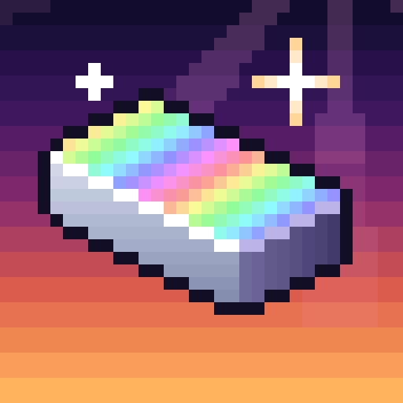

# Luxium

**Shader packs, on Metal.**

Run Iris / OptiFine shader packs on Minecraft's Metal backend, on Apple Silicon Macs.

   

---

## ✨ What is it?

Shader packs are written for OpenGL. On a Mac, the [Metallum](https://github.com/kokodio/metallum) mod replaces Minecraft's renderer with Apple's **Metal** API, which shader-pack mods like Iris don't support.

**Luxium is the missing piece.** It's a Fabric mod that sits next to Metallum and runs shader packs from your `shaderpacks/` folder as they are, without editing them. It:

- 📦 **reads the pack** the way Iris does: its folders, per-world programs and settings
- 🧩 **preprocesses** each program: `#include`, `#if` and the standard defines packs expect
- 🔁 **translates** the GLSL into a form that compiles to Metal Shading Language
- 🎛️ **supplies the uniforms** packs read: time, camera, weather, biome, held item and more
- 🌅 **runs the pack's render passes** on Metallum's Metal device

> [!NOTE]
> Luxium is in **early development** and can't show a shader pack in game yet. The render pipeline is being built now. The first target pack is Complementary Unbound.

## 🧰 Requirements

| | You need |
|---|---|
| **Computer** | Mac with Apple Silicon (M1 or later) |
| **Minecraft** | 26.3 |
| **Mod loader** | [Fabric Loader](https://fabricmc.net/) 0.19.5 or later |
| **Java** | 25 or later |
| **Required mod** | [Metallum](https://github.com/kokodio/metallum) |
| **Optional mod** | [Sodium](https://modrinth.com/mod/sodium) (Luxium is developed and tested with it installed) |
| **A shader pack** | Any Iris / OptiFine-format pack, placed in `.minecraft/shaderpacks/` |

## 💜 Credits

Luxium builds on the work of these projects:

| Project | What it gives Luxium | License |
|---|---|---|
| [**Metallum**](https://github.com/kokodio/metallum) by kokodio | The Metal backend that Luxium runs on | MIT |
| [**Iris**](https://github.com/IrisShaders/Iris) by the Iris contributors | The reference for how shader packs behave. Luxium reproduces many of its rules and tables in its own code. | LGPL-3.0 |
| [**Vitrail**](https://github.com/avpbynf/Vitrail-Shaders) by the Vitrail contributors | Prior art for running shader packs on a non-OpenGL backend (Vulkan), and the design of program-level translation | LGPL-3.0 |
| [**JCPP**](https://github.com/shevek/jcpp) | The C preprocessor that evaluates `#if` and `#define`, bundled unmodified | Apache-2.0 |
| **Complementary Shaders** by EminGT | The pack Luxium is tested against. It isn't included here. Get it from its official page. | Complementary License |

For exactly what was adapted from Iris and Vitrail, file by file, see [`mod/NOTICE`](mod/NOTICE).

Not affiliated with Mojang, Microsoft, Apple, Iris or OptiFine.

